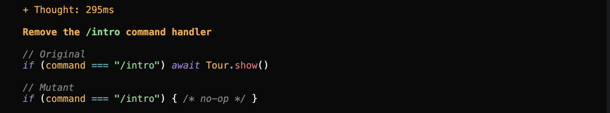

# Intro Tour Requirements

## R1

| Property            | Value                                                        |
| ------------------- | ------------------------------------------------------------ |
| ID                  | R1                                                           |
| Interview evidence  | C-2/S-7/S-8: “Show it once.” / “If I close it, don’t show it |
|                     | again unless I ask for it.”                                  |
| Requirement         | The tour automatically opens on the first launch. Don’t show |
|                     | it again unless with `/intro`.                               |
| Acceptance criteria | On the first login, launching OpenCode shows the tour. The   |
|                     | user closes it at step 2, quits, and relaunches: no tour     |
|                     | appears. The user types `/intro`: the tour appears.          |

## R2

| Property            | Value                                                        |
| ------------------- | ------------------------------------------------------------ |
| ID                  | R2                                                           |
| Interview evidence  | C-2/C-4/O-4: “The next button should bring to the next step, |
|                     | and so should the enter keyword”                             |
| Requirement         | The tour advances on user input, such as enter, presses, and |
|                     | arrow keys.                                                  |
| Acceptance criteria | Enter, pressing the next button, and the right arrow key     |
|                     | should move to the next step in the intro.                   |

## R3

| Property            | Value                                                        |
| ------------------- | ------------------------------------------------------------ |
| ID                  | R3                                                           |
| Interview evidence  | C-1/O-2: “should always have spotlight for the relevant part |
|                     | being interacted with”                                       |
| Requirement         | Depending on the step of the tour, it highlights the         |
|                     | relevant components that the user should be interacting      |
|                     | with.                                                        |
| Acceptance criteria | On the “Switch model” step, the model selector is            |
|                     | highlighted and everything else is dimmed. After advancing   |
|                     | to the “Connect an MCP server” step, the highlight moves to  |
|                     | that control and the model selector is no longer             |
|                     | highlighted.                                                 |

## R4

| Property            | Value                                                        |
| ------------------- | ------------------------------------------------------------ |
| ID                  | R4                                                           |
| Interview evidence  | C-1/O-2: “Never should just bring them into a simulation     |
|                     | without a skip button”                                       |
| Requirement         | A skip button should be visible during the tour.             |
| Acceptance criteria | Each step should have a skip button.                         |

## Requirement Types

| ID  | Requirement                                        | Type           |
| --- | -------------------------------------------------- | -------------- |
| R1  | The tour automatically opens on the first launch.  | Invariant      |
|     | Don’t show it again unless with `/intro`.          |                |
| R2  | The tour advances on user input, such as enter,    | Model / oracle |
|     | presses, and arrow keys.                           |                |
| R3  | Depending on the step of the tour, it highlights   | Invariant      |
|     | the relevant components that the user should be    |                |
|     | interacting with.                                  |                |
| R4  | A skip button should be visible during the tour.   | Invariant      |

## Handwritten Mutants

Each patch in `mutants/vvishwan/` changes `packages/tui/src/feature-plugins/home/intro.tsx`. Each one was
applied separately and checked from `packages/tui` with all three intro test files:
`bun test test/feature-plugins/intro.test.tsx test/feature-plugins/intro.property.test.ts test/feature-plugins/intro.opencode.property.test.ts`.
The unmutated code passes 34/34.

The launch setting is the `intro_hide_on_launch` key that the launch row toggles. My R1 rule turns it on
the first time the tour auto-opens, so the tour isn't shown again.

| ID | Requirement targeted | Change | Predicted killer | Actual result |
| -- | -------------------- | ------ | ---------------- | ------------- |
| H1 | R1 | Moves the `api.kv.set("intro_hide_on_launch", true)` save from "when the tour auto-opens" to "when the user reaches the last step." Someone who closes the tour partway through never has it marked as seen, so it opens again on every launch. | R1 property test (it closes the tour after 0–5 steps, then relaunches) | **Killed.** 2 tests fail: the R1 property test and "opens on the first launch and saves that it was seen" (`intro_hide_on_launch` is never set to `true`). |
| H2 | R2 | Changes `advance()` from `Math.min(expanded() + 1, STEPS.length - 1)` to `(expanded() + 1) % STEPS.length`. Going past the last step now wraps to step 1 when it should stay on the last step. | R2 property test (it checks that the open step equals `min(first + n, count - 1)`) | **Killed.** 1 test fails: the R2 property test. |
| H3 | R1 | Stops reading and saving `intro_hide_on_launch` at launch, so the only "already shown" check left is the in-memory `autoOpened` variable. That state only lasts while the process runs, so the tour opens again on every new launch. | R1 property test (it uses a fresh copy of the module for each launch and carries the saved settings over) | **Killed.** 3 tests fail: the R1 property test, "opens on the first launch and saves that it was seen," and "once the tour has been seen, the next launch stays closed." |
| H4 | R2 | Changes the **Next →** click handler from `advance` to `setExpanded((step) => step + 1)`. It skips the last-step limit and doesn't move the selection, so clicking Next on the last step goes past the end. | R2 property test (the `"next"` input on the last step) | **Killed.** 1 test fails: the R2 property test. |
| H5 | R4 | On the last step, the **Skip tour** label changes to "Finish," so no skip button shows on that step. | R4 property test (it checks for "Skip tour" after every move) | **Killed.** 1 test fails: the R4 property test. |

Mutation score for the handwritten mutants: **5/5 killed (100%)**. No mutant was killed only by a test
aimed at a different requirement. Each one was caught by the property test for the requirement it targets.

## Stryker Comparison

Stryker ran with `packages/tui/stryker.vvishwan.config.json`. It only mutated the lines in `intro.tsx` behind
R1–R4: `open()`, `advance()`, the spotlight effect, the key bindings, the Next/Skip buttons, and the
`/intro` command plus the first-launch auto-open. The only tests it ran were the R1–R4 property tests in
`intro.test.tsx` (`-t "^R[1-4]:"`). The full report is in `mutants/vvishwan/mutation.html`.

**Mutation score: 39 / 42 killed = 92.9%** (3 survived, 0 timeouts, 0 no-coverage).

The four command-metadata mutants (28–31, which set `title`, `slashName`, `category` and `namespace` to `""`)
are killed, but not because a test checks them. The keymap rejects empty metadata when the command is
registered (`Keymap metadata field "title" cannot be empty`), so the test setup crashes. A non-empty typo
such as `slashName: "intor"` would still pass every test.

### Surviving mutants

| Stryker ID | Line | Mutation | Why it survived |
| ---------- | ---- | -------- | --------------- |
| 4  | 137 | `setSize("large")` → `setSize("")` | No test checks the dialog's size. |
| 10 | 217 | `setAnswered(false)` → `setAnswered(true)` in `advance()` | The R2 property test checks which step is open, but never checks whether a FAQ answer is showing after the user advances. |
| 12 | 221 | `setSelected(next)` deleted from `advance()` | The R2 test reads the open step (▾) from the frame, but never checks where the `›` cursor is. |

### Which of my handwritten mutants did Stryker never generate? Why not?

Stryker never generated **H2, H4 or H5**, and it only generated one half of **H1** and **H3**:

- **H1** has two parts: stop saving at launch, and save on the last step instead. Stryker's mutant 48
  (`kv.set("intro_hide_on_launch", true)` → `false`) has the same effect as the first part, but Stryker
  never adds the new "save on the last step" effect.
- **H3** also has two parts: stop reading the saved setting at launch, and stop saving it. Stryker's mutant 42
  replaces the whole launch check with `false`, and mutant 48 stops the save. It only makes one change per
  mutant, so it never combines the two.
- **H2** (`Math.min(x, max)` → `(x) % length`): Stryker's MethodExpression and ArithmeticOperator mutators
  only swap `min`↔`max` and `+`↔`-` (mutants 6, 7, 8). No operator turns a clamp into a modulo.
- **H4** (`onMouseUp={advance}` → `() => setExpanded(step + 1)`): Stryker does not mutate plain identifier
  references like `advance`. It also never rewrites one call path into a different one that skips a helper.
- **H5** (`Skip tour` → `Finish` on the last step): `Skip tour` is JSX text, not a string literal, so
  StringLiteral never touches it. Stryker also never adds a conditional expression.

All of these come from asking how a developer might misread a requirement. Each one moves logic, replaces it,
adds to it, or changes more than one place at once. Stryker's operators only make one small local
substitution in code that already exists.

### Which Stryker survivors would I never have thought of? Are any of them plausible real bugs?

I would not have thought of **10** or **12** (the extra state updates inside `advance()`). I was focused
on what the tour *shows*, not on the side state that `advance()` also has to keep in sync.

Two of the three are bugs a real developer could easily write:

- **12 (drop `setSelected(next)`) is the most plausible one.** The comment in `advance()` exists
  because syncing the selection is easy to get wrong. Without it, the right arrow opens the next step
  but leaves the cursor behind, so the next Enter acts on the wrong row. That is a real R2 usability bug
  that my tests miss.
- **10 (`setAnswered` wrong or missing) is plausible.** Forgetting to reset UI state on navigation is a common bug.
  An example test ("an open answer closes when you move to another step") covers this for clicks, but
  not for `advance()`, and Stryker only ran the property tests.
- **4** is a possible copy-paste mistake, but it is cosmetic: it only changes the dialog size and doesn't
  break a requirement.

### What does each approach find that the other doesn't?

- **Handwritten mutants find requirement-level gaps.** Each one models a believable misunderstanding:
  "seen means finished" (H1), "wrap around at the end" (H2), "remember it in memory" (H3),
  "skip the shared helper" (H4), "no skip on the last step" (H5). They test whether the oracle
  catches a whole wrong behavior. Stryker can't generate these because they move, replace or add code, or
  change more than one place at once. All five were killed, which shows that the property tests encode the R1–R4 behavior.
- **Stryker finds oracle blind spots I didn't know about.** It tries every small change and shows exactly
  which observable effects my tests never check: the cursor position and the answered state reset on
  advance. Those are the places I didn't think to look, so I wouldn't have written mutants for them.
- **Stryker can also overstate what the tests check.** Mutants 28–31 count as killed only because the
  keymap crashes on empty metadata. No test checks that `/intro` is the slash name.
- **Follow-ups suggested by the results:** assert the `›` cursor in the R2 property, assert that no FAQ
  answer is showing after an advance, and have the R1 property open the tour by looking up the command
  by its `slashName` (`intro`) instead of by its internal name.

## Agent Failure Case

It keeps the first launch logic the same, so it would probably still open every launch, and this is a case of a generator that never reaches the bug, because it just removes the command it doesn't edit the launch logic at all.